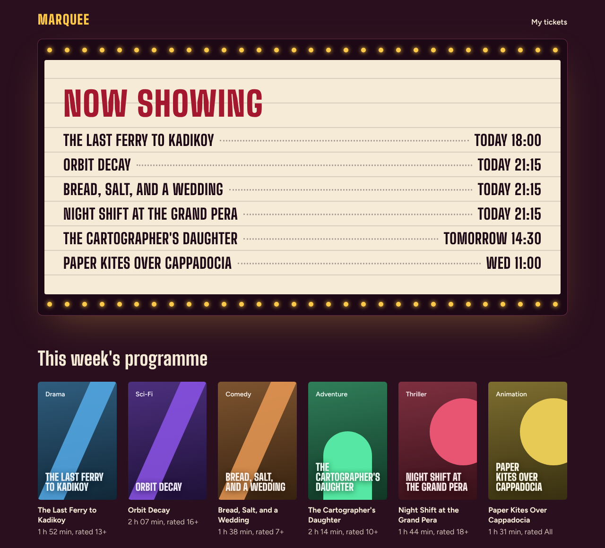
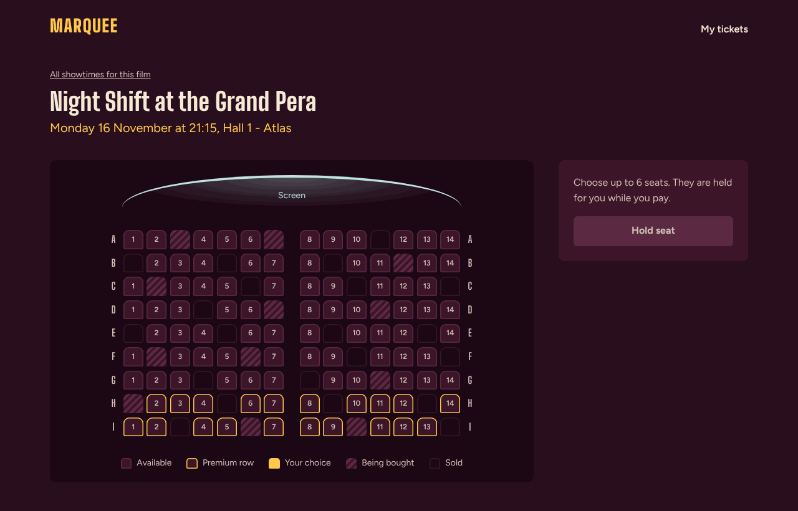
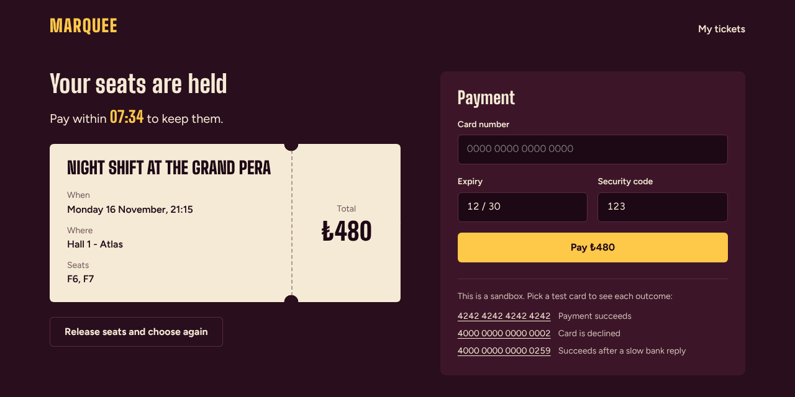
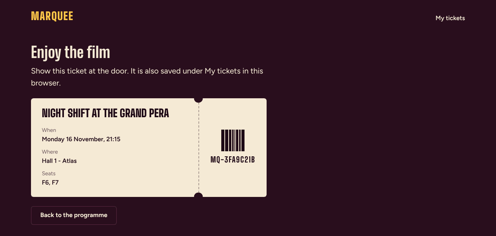
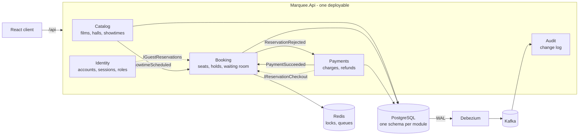
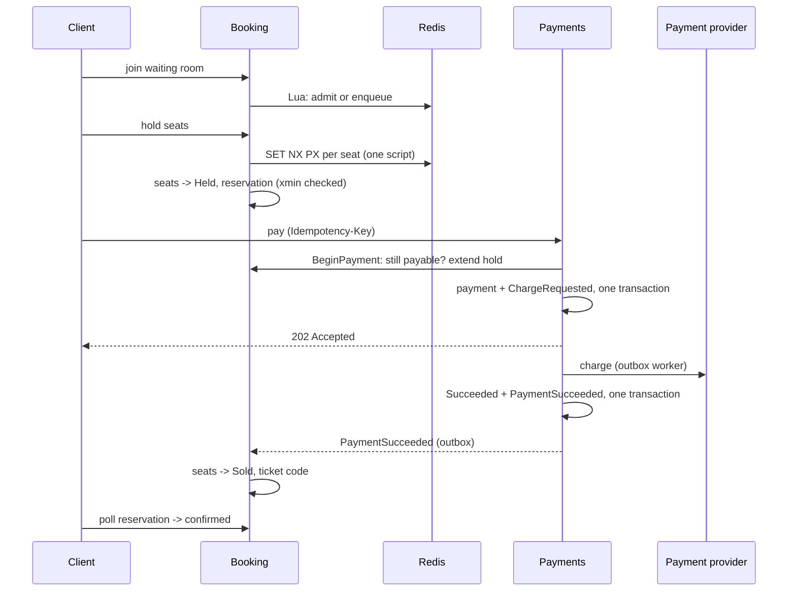

# Marquee

[](https://github.com/emrecanAy/marquee/actions/workflows/ci.yml)

Ticketing for a small cinema: films, halls, showtimes, and a seat map where one seat can only ever be sold once, also when a premiere opens and everybody clicks the same seat in the same second.

A .NET 10 modular monolith with a React front end. PostgreSQL is the source of truth, Redis takes the stampede, an outbox carries events between modules and to the payment provider, and Debezium turns the write-ahead log into an audit trail.



| Choosing seats | Paying | The ticket |
|---|---|---|
|  |  |  |

## What it solves, and where to look

| Problem | Mechanism | Code | Proven by |
|---|---|---|---|
| Many customers want the same seat at once | `SET key owner NX PX ttl` in Redis: atomic, one winner, everyone else is turned away in memory. Several seats are claimed all-or-nothing by one Lua script. | [`SeatLocks`](src/Modules/Marquee.Booking/Seats/SeatLocks.cs) | `One_hundred_visitors_racing_for_the_same_seat_produce_exactly_one_hold` |
| Redis loses a lock (failover, eviction) | Redis is only the fast path. The seat row's status, and its `xmin` row version as a concurrency token, still refuse a second owner. | [`Seat`](src/Modules/Marquee.Booking/Domain/Seat.cs), [`HoldSeats`](src/Modules/Marquee.Booking/Reservations/HoldSeats.cs) | `When_the_redis_lock_is_lost_...`, `Of_two_transactions_updating_the_same_seat_version_only_the_first_commits` |
| "Charged, but the booking was lost" | Outbox: the payment row and the instruction to charge it are one transaction. A worker calls the provider; the outcome and its event are again one transaction. | [`PayReservation`](src/Modules/Marquee.Payments/Features/PayReservation.cs), [`OutboxProcessor`](src/Marquee.Common/Messaging/OutboxProcessor.cs) | `A_successful_payment_turns_the_hold_into_sold_seats_and_a_ticket` |
| Double click or network retry on "Pay" | `Idempotency-Key` with a unique index; a second index allows one in-flight or completed payment per reservation. | [`PaymentsDbContext`](src/Modules/Marquee.Payments/Persistence/PaymentsDbContext.cs) | `Retrying_with_the_same_idempotency_key_...` |
| The money arrives after the hold expired | Compensation: Booking rejects the confirmation, Payments refunds. | [`PaymentSucceededHandler`](src/Modules/Marquee.Booking/Reservations/PaymentEventHandlers.cs) | `A_charge_that_lands_after_the_hold_expired_is_refunded` |
| A premiere floods seat selection | Virtual waiting room on Redis sorted sets: a fixed number of shoppers per showtime, the rest queue in arrival order. | [`WaitingRoom`](src/Modules/Marquee.Booking/Admission/WaitingRoom.cs) | `WaitingRoomTests` |
| Abandoned checkouts keep seats | Holds expire. A sweep with `FOR UPDATE SKIP LOCKED` frees them and is safe on every instance. | [`ReservationExpiry`](src/Modules/Marquee.Booking/Reservations/ReservationExpiry.cs) | `An_expired_hold_puts_its_seats_back_on_sale` |
| A stolen or copied sign-in | Short access token held in memory, refresh token in an `HttpOnly` cookie that rotates on every use. Presenting an old one ends the whole session. | [`Sessions`](src/Modules/Marquee.Identity/Auth/Sessions.cs) | `A_refresh_token_used_twice_ends_the_session` |
| Password guessing | Per-address lockout counted in a locked row, a rate limit per IP, the same answer and timing for unknown addresses. Optional TOTP with one-time recovery codes. | [`SignIn`](src/Modules/Marquee.Identity/Auth/SignIn.cs), [`Totp`](src/Modules/Marquee.Identity/Auth/Totp.cs) | `IdentityTests` |
| A staff endpoint shipped without a check | Every endpoint needs a session unless marked anonymous; staff endpoints declare a permission. Tests fail on a new anonymous route or a staff route without one. | [`Permission`](src/Marquee.Common/Security/Permission.cs) | `AuthorizationTests` |
| "Who changed this row, and when?" | CDC: Debezium reads the WAL into Kafka and a consumer stores every change with before/after values. Application code writes no audit records. | [`ChangeEventConsumer`](src/Modules/Marquee.Audit/ChangeEventConsumer.cs) | End-to-end in the compose stack, see below |

## Run it

Requirements: Docker. Nothing else.

```bash
docker compose up --build
```

- App: http://localhost:8080
- API reference: http://localhost:5080/docs

The first start applies the migrations and seeds six (invented) films with four days of showtimes.

**With the audit trail** (adds Kafka and Debezium, takes about a minute longer to start):

```bash
docker compose -f compose.yaml -f compose.cdc.yaml up --build
```

Then buy a ticket, sign in as the auditor (below) and open **Audit trail**.

### Accounts

Buying needs no account: the first visit opens a guest session that owns the holds and tickets. Signing in or creating an account later keeps them, and the tickets then show on every device.

| Who | E-mail | Can |
|---|---|---|
| Administrator | `admin@marquee.local` | everything, including staff accounts |
| Programmer | `programci@marquee.local` | schedule showtimes |
| Auditor | `denetci@marquee.local` | read the audit trail |
| Customer | `seyirci@marquee.local` | buy, see own tickets |

The administrator's password is `marquee-platform-2026`, the others use `marquee-demo-2026`. These come from `compose.yaml` and the demo seed; production reads them from `.env` ([docs/deployment.md](docs/deployment.md)).

### Things to try

- **The race.** Open the same showtime in a normal and a private window, pick the same seat in both and press "Hold". One gets the seat, the other is told it was just taken.
- **The waiting room.** `WAITING_ROOM_CAPACITY=1 docker compose up`, then open a showtime in two different browsers. The second waits at position 1 and is let in when the first buys or leaves.
- **Expiry.** `HOLD_DURATION=00:01:00 docker compose up`, hold seats and watch the countdown give them back.
- **Payment outcomes.** The checkout lists three test cards: approved, declined, and a slow bank.
- **Roles.** Sign in as the programmer and add a showtime; its seats are on sale at once. Then, as the administrator, change the programmer to auditor: the open tab loses the programme page within seconds.

### Working on the code

```bash
docker compose up -d postgres redis      # infrastructure only

dotnet run --project src/Marquee.Api     # API on http://localhost:5080  (.NET 10 SDK)
cd web && npm install && npm run dev     # web on http://localhost:5173  (Node 22)
```

```bash
dotnet test                              # needs Docker: Testcontainers starts PostgreSQL and Redis
cd web && npm run lint && npm test
```

## Architecture



**Module rules.** Each module is its own project with its own `DbContext`, schema, migrations and outbox table. Modules never reference each other: they share only the contracts in `Marquee.Common` (integration events, plus one interface for the single synchronous call). Everything inside a module is `internal`. `ArchitectureTests` fails the build if either rule is broken, so splitting a module out later means moving a project, not untangling one.

**Buying a ticket.**



## Design notes

**Two layers for one seat.** Redis answers "who was first" in microseconds and keeps a thousand losers away from the database. But a lock in Redis can vanish, so it is never trusted on its own: the hold is also written to the seat row, guarded by its status and by `xmin`. PostgreSQL bumps `xmin` on every update, which makes it a free row version: no extra column, and it cannot be forgotten in an `UPDATE`.

**Why the provider is not called in the request.** `SaveChanges(); gateway.Charge();` loses a charge if the process dies between the two, and holds a database transaction open across a network call if you wrap them. With the outbox the request only records intent. The charge is retried until it has an answer, and the provider deduplicates by payment id, so a retry never charges twice.

**At-least-once, so handlers check state.** An event can be delivered again after a crash. Every handler starts by asking whether its work is already done (`reservation.Status == Confirmed`, screening already exists) instead of relying on exactly-once delivery that no broker really gives.

**The waiting room has no counters.** A common design keeps an `active` counter with `INCR`/`DECR` and must remember to decrement on every exit path. Here admitted sessions live in a sorted set scored by when their admission ends; expired members are trimmed on each operation. A customer who closes the tab frees the place without any code running for them. Waiting sessions that stop polling are skipped the same way.

**Guests first, accounts optional.** A visitor gets a guest session on first use: it owns their place in line, their holds and their tickets. An account is only needed to see tickets on another device. Signing in keeps the guest session's id, and Booking stamps the account on that session's reservations, so nothing is lost on the way. A reservation belongs to whoever holds its session or its account; anyone else gets 404, not 403, so ids cannot be probed.

**Sessions.** The access token lives for 15 minutes and only in memory, so a script injected into the page cannot find it in storage. The refresh token sits in an `HttpOnly`, `SameSite=Strict` cookie limited to `/api/auth`, is stored as a hash and replaced on every use. If an old one comes back, someone copied it, and the whole chain is revoked. Tabs share one refresh through a Web Lock so they do not trip that check on each other. Auth calls must carry `X-Requested-With`, which a cross-site form cannot set.

**Roles and permissions.** Endpoints check permissions (`catalog.schedule`, `audit.read`, `staff.manage`), and each permission lists the roles that hold it; the administrator holds all. Every account token carries a session version. Changing a role, resetting a password or switching an account off bumps it, and the API rejects older tokens within seconds instead of waiting for them to expire. New staff get a temporary password that only allows choosing a new one.

**No MediatR, no repositories.** A handler is a class with one method, registered in DI and called by its endpoint; a query is a LINQ projection in the endpoint. EF Core already is a unit of work, and the integration tests run against real PostgreSQL, so an abstraction layer for swapping it out would only add indirection.

**CDC over application-level audit logging.** Audit rows written by application code are only as complete as the code paths that remember to write them. The WAL contains every committed change, including ones made by a migration or by hand in `psql`.

## Repository layout

```
src/
  Marquee.Api/               composition root, security headers, health
  Marquee.Common/            Result type, outbox, integration event contracts
  Modules/
    Marquee.Catalog/         films, halls, showtimes; publishes ShowtimeScheduled
    Marquee.Booking/         seat inventory, Redis locks, reservations, waiting room, expiry
    Marquee.Payments/        payments, idempotency, fake provider, refunds
    Marquee.Audit/           Kafka consumer for Debezium change events
    Marquee.Identity/        accounts, sessions, sign-in, two-step codes, staff
tests/Marquee.Tests/         integration (Testcontainers), domain and architecture tests
web/                         React 19 + TypeScript + Vite + TanStack Query
deploy/                      production compose file, Debezium connector
.github/workflows/           ci.yml, cd.yml
```

## CI/CD

- **CI** (`ci.yml`) on every push and pull request: build with warnings as errors, a check that every model change has a migration, all .NET tests against real PostgreSQL and Redis, web lint/tests/build, and both container images.
- **CD** (`cd.yml`): a `v*` tag publishes the images to GHCR. The deploy job (SSH, `docker compose pull && up`, health check) is already written but stays skipped until the repository variable `DEPLOY_ENABLED` is set. [docs/deployment.md](docs/deployment.md) lists the six settings that switch it on.

## Deliberately left out

- **A real payment provider.** `FakePaymentGateway` is slow, can decline and is idempotent, which is what the surrounding design depends on. The browser-side "tokenisation" is a stand-in for a provider SDK; card numbers never reach the API either way.
- **E-mail.** No address verification or password-reset mail; an administrator resets staff passwords. Customers who forget theirs can still buy as guests.
- **Editing films and halls.** Programmers schedule showtimes; films and halls come from the seed, which also plans four days ahead at start-up.
- **Live push.** The seat map polls every three seconds. Server-sent events over Redis pub/sub would be the next step.
- **Kafka between modules.** In one process the outbox dispatches in memory. Kafka appears only where something outside the application (Debezium) produces the messages.

## Acknowledgements

The problem set follows [TicketGate](https://github.com/hakanyusufoglu/TicketGate) by Hakan Yusufoğlu, which tackles the same questions for concert tickets. Marquee is an independent implementation with a different domain, structure and code.

## License

MIT
